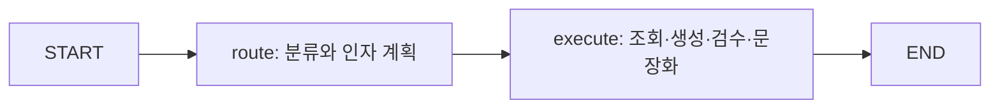
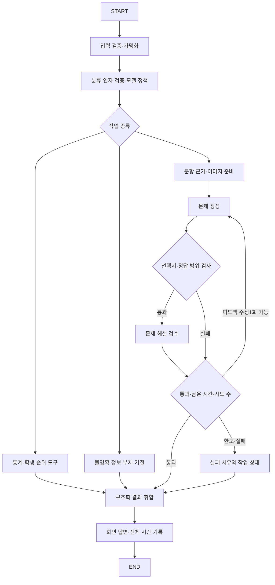

# 수업·설계·현재 구현 대조

검토일: 2026-11-08. 기준 구현 커밋 b6b2f26157e4c7f3dc9125795311152a01f2d4b3.
이후 반영한 공통 전처리·조건부 그래프·실패 격리·자원 재사용은 [후속 실행 구조](workflow.md)에 기록했다. 아래 내용은 당시 감사 결과로 보존한다.
AI가 정적 코드·수업 자료를 대조하고 합성 진단을 실행했다. 이 보고서 작성으로 앱 코드를 수정하지 않았으며 실제 API를 호출하지 않았다.

## 판정

기능 연결과 모의 검증은 되어 있지만, 처음 후보 설계도의 모든 노드·조건부 엣지·검수 루프가 구현된 상태는 아니다. 이전 단계의 완료는 각 단계에서 명시한 구현/모의 검증 범위다. 운영 정확도와 지연시간의 보장은 아니다.

| 항목 | 현재 구현 | 판정 |
| --- | --- | --- |
| 개인정보 전처리 | chat.py masked, 학생 가명/이메일/휴대전화 처리 | 기능 있음. 중앙 middleware 또는 독립 그래프 노드는 아님. 원문 이미지 픽셀 마스킹 없음 |
| 입력 가드레일 | blocked와 라우터 지침 | 일부 구현. 한국어 특정 표현만 로컬 차단하며 모든 변형 차단은 미검증 |
| 모델 선택 | 라우터의 complex에 따라 생성/검수 Sol 또는 Astra | 있음. 난이도/남은 시간 기준·실측에 따른 최적성 검증 없음 |
| 일반 조회 | 라우팅1회 후 로컬 Python 결과 반환 | 구현. 생성 모델 추가 호출 없이 숫자를 반환 |
| 조회 도구 | Python 함수 직접 호출 | 업무 도구 역할은 있으나 LangChain @tool 객체를 모델에 바인딩한 구성은 아님 |
| State | plan, answer 두 필드 | 유효하지만 진단/설계 계약이 부족. 나머지는 함수 캡처와 Streamlit 세션에 분산 |
| Node | route, execute 두 개 | 유효하지만 조회/생성/검수/실패가 execute에 합쳐짐 |
| Edge | START→route→execute→END | 컴파일 정상. add_conditional_edges는 현재 없음 |
| 생성 평가 | 코드 형식 검사와 Review 승인1회 | 있음. feedback 반영 재생성 루프는 없음; Review.reason은 후속 처리에 쓰이지 않음 |
| 병렬 처리 | PDF 이미지 변환을 별도 스레드로 위임 | fan-out/fan-in 워크플로우 아님. 파일 파싱과 작업 목록 실행은 순차 |
| Orchestrator–Worker | 최대6개 Task 계획과 순차 실행 | 축소된 계획/실행 기능. Send 기반 동적 Worker·reducer 없음 |
| Jev / Decisions | 호출 없음 | 둘 다 미도입 |
| 실행 관측 | 전체 elapsed, status | 노드별 소요시간·실제 선택 모델·호출 수·토큰·실패 지점 기록 부족 |

## 실제 그래프

합성 백엔드로 실제 컴파일 객체의 get_graph()를 확인했다.

검증/마스킹은 그래프 호출 앞에서 수행하며, execute가 내부 if/elif로 작업을 구분한다. 기능상의 라우팅이 있다는 사실과 그래프에 조건부 엣지가 있다는 사실은 구분해야 한다. 초기 설계 문서는 당시의 후보/역사 기록이므로 완료 상태의 코드 설명으로 읽으면 안 된다.

## 우선 보완할 구조

후보 구조이며 아직 코드로 바꾸지 않았다. 노드를 나눈다고 모델 호출 수를 늘릴 필요는 없다. 조건부 엣지 자체가 정확도를 보장하지도 않는다. 실패 격리·관측·검수 정책을 명확히 하기 위한 변경이다.

State에는 다음 노드가 실제로 사용하는 가명 입력, 검증된 작업/인자, 구조화 task_results, 생성 문제, review 승인/피드백, 시도 수, 남은 시간, 모델/도구 호출 기록, 단계 상태를 둔다. API 키와 대용량 원본/이미지는 State·로그에 복사하지 않는다. 학생 원본/분석 결과는 세션 전용 컨텍스트로 참조한다. 장기 자기소개 대상은 최근12메시지에만 의존하지 않고 파일 버전과 연결해 별도 보존할 수 있다. 자기소개는 실제 본인 인증이 아니다.

## 재현된 보완점

1. 합성 계획에 통계→문제 생성 작업을 넣고 뒤쪽 생성에 예외를 주면 최종 status=error이고 먼저 계산한 통계 답변이 소실됐다. 작업별 성공/실패 결과와 취합 정책이 필요하다. 일부 작업 성공을 전체 질문 정답으로 채점하면 안 된다.
2. 이미지 변환에0.20초의 합성 지연을 주고 그래프 한도를0.02초로 설정했다. reply.elapsed는 약0.028초였지만 asyncio.run 호출 전체는 약0.206초였다. 스레드 작업의 종료 대기까지 포함한 외부 경과시간을 측정해야 한다. 이것은 실제 서비스 속도 측정이나20초 초과 관측이 아니다.
3. 일반 예외 안내는 안전하지만 실패 단계·모델·경과시간 정보가 없어 튜닝 근거가 부족하다. 원문/키를 제외한 진단 필드가 필요하다.
4. 같은 모델 계열의 Review 승인만으로 실제 문제의 정답 유일성이 입증되지는 않는다. 실제 생성물의 독립 풀이/사람 검토가 필요하다.

## Jev와 Decisions 판정

수업 PDF의 TypeSafe Jev와 Jev 노트북의 OpenAI Decisions 호출은 다른 서비스다. Jev는 typed questions의 choice/score/noul 등, Decisions는 choice/predicate/score를 제공한다. 현재 코드의 Responses 구조화 출력은 이 둘 중 어느 것도 아니다.

- TypeSafe Jev: 분류만 대체하는 비교 실험 후보로 적절하다. 공급자/인증/데이터 전달 경로가 추가된다. 소개 자료의 배수/지연시간 수치를 이 앱의 보장치로 사용할 수 없다.
- OpenAI Decisions: 기존 OpenAI 경로 안에서 비교하기 편한 후보다. 확인일 공식 문서는 지원 모델을 gpt-6-luna로 한정한다. 현재 앱의 허용 목록 Sol/Astra와 다르므로 묵시적으로 교체하면 안 된다. 답변 생성 모델은 유지하고 판단 단계만 별도 정책으로 평가해야 한다.
- 현재 라우터는 카테고리뿐 아니라 학생 가명·목표 등수·문항 번호·복합 작업을 한 번에 추출한다. choice만 빠르게 바꾸면 인자 추출을 잃거나 별도 호출이 늘 수 있다. 단계 시간이 아닌 완성 답변 전체로 비교해야 한다.
- confidence/확률은 해당 판단의 정답률 측정값이 아니다. 높은 confidence라도 오분류할 수 있다. 낮은 확신도에서 기존 모델로 돌아가는 경로도 남은 시간/추가 호출 비용에 따라 평가한다.
- **결론: 실험 도입 가치는 있으나 본선 기본 경로 교체는 보류한다.** 실제 질의에서 기준 모델과 동등 이상의 정확도, 낮은20초 실패율, 복합 인자/문맥/거절 처리 보존을 확인한 뒤 채택한다. 현재 Jev/Decisions의 실 API 벤치마크는 하지 않았다.

## 다른 기법의 채택 판단

| 기법 | 판단 | 근거/전제 |
| --- | --- | --- |
| 세션별 분석 재사용 | 유지 | 이미 구현. 질문마다 PDF·채점을 반복하지 않음 |
| 같은 요청 안의 SDK 클라이언트 공유 | 우선 검토 | 현재 각 분류/생성/검수 호출마다 클라이언트를 열고 닫음. 연결 재사용을 비교. 다른 asyncio.run 루프나 다른 사용자 사이의 전역 공유는 피함 |
| 원문 이미지 세션 캐시 | 우선 검토 | 파일 해시·페이지·해상도로 식별, 자료 변경 시 삭제. 같은 페이지 반복 렌더링 감소. 효과는 실측 필요 |
| 단계별 프롬프트 분리 | 우선 검토 | 현재 route에도 생성/검수 지시 전체가 들어감. 필요한 계약만 보낼 수 있으나 분류 정확도 재검증 필요 |
| 최소한의 로컬 빠른 경로 | 제한적 비교 | 계산/명확한 입력 검증은 로컬. 모호한 자연어를 키워드만으로 강제 분류하지 않음. 예상 질문/정답 하드코딩 금지 |
| 병렬화 | 의존성 있는 작업은 제외 | 생성 전 검수 실행 불가. 계산 조회는 이미 작아 병렬 비용이 더 클 수 있음. 개인정보 처리 전 외부 호출을 병렬 실행하면 안 됨 |
| 검수→수정 반복 | 시간 여유가 있을 때1회 후보 | 품질 개선 가능성이 있으나 호출·지연 증가. 무조건3회 반복은 부적합 |
| 스트리밍 | UX 선택사항 | 첫 토큰 표시가 빨라도 답변 전체20초 조건을 통과한 것은 아님 |
| Multi-Query·reranker·GraphRAG | 현재 핵심 경로 보류 | 번호로 확정 조회하는 점수/문항에 새 검색 지연과 오조회 가능성 추가. 유형 기반 광범위 문서 검색을 추가할 때 별도 평가 |
| Entity linking | 유지/보완 | 학생 번호 표현 정규화가 실제 실패 해결에 직접 필요했음. 지식 그래프 구축 없이도 적용 가능 |
| RAGAS·LLM judge | 오프라인 보조 | 숫자는 독립 계산으로, 근거는 문항/페이지 연결로 검증. 매 조회에 judge를 붙일 필요 없음 |
| LangSmith | 선택적 개발 도구 | 현재 추적은 끔. 먼저 익명화한 로컬 단계/호출 시간 기록. 원본 학생 자료와 키를 외부 추적으로 보내지 않음 |
| 전체 ReAct/동적 Worker | 현재 기본 경로 보류 | 필요한 도구/문항이 적고 명확함. 불필요한 계획·반복 호출의 시간 부담 |

## 비교 실험과 채택 조건

3주차의 검색/생성/속도 분리와 한 번에 하나의 개선 원칙을 따른다.

1. 실 모델 기준선: 요구6유형과 번호/띄어쓰기/후속 대화/동점/복합 질문/없는 정보/공격 변형을 포함한다. 개발용과 미사용 확인용 질문을 분리한다. 기준선부터 실제 모델 분류·인자·답변의 오류를 기록한다.
2. 정답 계산·근거 연결·답변 정확도·생성 문제의 유일 정답/해설을 각각 판정한다. 자체 judge 승인만을 정답 기준으로 쓰지 않는다.
3. 같은 입력으로 반복 측정하고 새 대화/후속 대화, 초기/반복 요청, 모델과 설정을 구분한다. 분류·이미지·생성·검수 시간과 호출 수, 외부 벽시계 전체 시간의 중앙값/상위지연/20초 실패 수를 기록한다.
4. 기존 Responses, Decisions 대체, Jev 대체를 한 번에 하나씩 비교한다. 요청 전후에 분류 판단을 하나 더 추가하는 방식은 추가 지연도 포함한다.
5. 이 고정 검증셋에서 정확도 저하가 없고 각 중요 유형의 실패가 늘지 않으며 전체 지연이 개선될 때 채택 후보로 삼는다. 유한한 검증셋의 동률을 모든 미래 질문에 대한 동등성 증명으로 부르지 않는다. 변경은 개별 커밋으로 되돌릴 수 있게 한다.

## 검토 자료 범위

- 1주차 LangChain.pdf 참고자료88~109쪽: System Prompt, ReAct/Plan-and-Execute/Reflection/Loop, Jev, Lost in the Middle, LangSmith.
- 2주차 RAG_Basic.pdf 캐싱99~100쪽·응용123~137쪽: 캐시, retrieval/rerank, Agentic/Hybrid, 파싱 노이즈.
- 3주차 3_RAG_Adv.pdf 평가50~58쪽·참고59~106쪽: 단계별 평가, RAGAS/judge, 실패 유형별 개선, 온톨로지/지식 그래프/엔티티 연결/LLM Wiki.
- 4주차 TalkFile_LangGraph.pdf.pdf 참고56~65쪽: 필요한 raw 구조화 State, Workflow/Agent 차이. 기본 LangGraph.pdf와 같은 관련 항목도 확인.
- 5주차 TalkFile_LangGraph_Adv.pdf.pdf: 패턴·마스킹 본문 및 참고69~93쪽. LangGraph_Adv.ipynb와 Jev.ipynb의 관련 State·node·edge·가드레일·판단 호출 셀을 정적으로 확인했다. 노트북을 실행하거나 셀 출력/키를 복사하지 않았다.
- 프로젝트/5주차_고객의뢰_배포준비의 아키텍처_설계_가이드.md 및 최종평가_요구사항과설계연계.md.

수업 자료의 관련 기법을 대조한 범위다. 모든 외부 링크·동영상의 전체 내용을 검증했다고 주장하지 않는다. 교재 수치를 실측치로 취급하지 않는다.

공식 문서 확인일 2026-11-08:
- https://docs.typesafe.ai/introduction
- https://typesafe.ai/blog/introducing-system-one-models-and-jev
- https://developers.openai.com/api/docs/guides/decisions
- https://docs.langchain.com/oss/python/langchain/middleware/overview
- https://docs.langchain.com/oss/python/langgraph/workflows-agents
