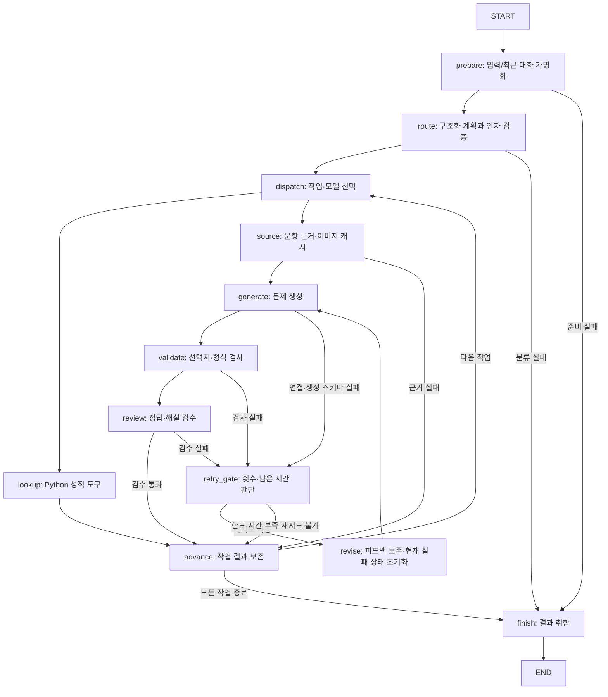

# 참고 기법 반영 후 실행 구조

2026-11-08. 앞선 architecture-audit.md는 당시 구현의 감사 기록으로 유지한다. 이 문서는 그 후 반영한 구조와 한계다.

## 실제 노드/연결

등록 노드는12개다. 실패/조회/생성/다음 작업/수정 여부를 add_conditional_edges로 연결한다. 생성은 최초 포함 최대2회다. 최대6개 계획 작업·그래프 recursion_limit70·전체18초 비동기 한도를 둔다. 단순 성적 조회의 모델 호출은1회, 첫 생성 승인 시3회, 검수 실패 뒤 수정·재검수까지 수행하면 최대5회다. 원문 이미지는 수정 시 다시 변환하지 않는다.

## State와 실행 컨텍스트

- State: 가명화 질문·최근 대화, Plan, 현재 task_index, task_results, pending, 문항 source, 생성 draft, 검수 review와 reason, 선택 모델, attempt_count, feedback, retryable, retry_allowed, retry_decision, retry_required_seconds, deadline_at, fatal, 최종 answer.
- API 키·SDK 클라이언트·원본 PDF·이미지는 그래프 State/진단 기록에 넣지 않는다. 호출 범위/현재 사용자 세션 컨텍스트에서만 사용한다. 답변 State 자체는 조회 학생의 표시 이름을 포함할 수 있으므로 State를 외부 로그에 그대로 복사하면 안 된다. LangSmith 추적은 끈다.
- PrivacyMiddleware.transform은 모델로 보낼 모든 단계의 payload를 재귀적으로 처리한다. 학생 가명화·이메일/휴대전화 마스킹을 분류·생성·검수에 공통 적용한다. LangChain create_agent 전용 middleware 데코레이터를 사용하는 구성은 아니며, 직접 SDK 워크플로우의 공통 호출 경로다. 이미지 픽셀은 마스킹하지 않는다.
- 최근12메시지와 별도로 자기소개 학생 가명을 세션에 보존한다. 자료/설정/분석 버전 변경 시 해당 가명·대화·이미지 캐시·진단 결과를 지운다. 알 수 없는 번호가 명시되면 예전 신원을 임의 재사용하지 않는다. 실제 본인 인증 기능은 아니다.

## 성능 관련 변경

1. OpenAIBackend.request_session이 질문 한 번에 AsyncOpenAI 클라이언트 하나를 열고 분류/생성/검수가 공유한다. 종료 시 닫으며 다음 질문의 별도 asyncio 루프·다른 사용자와 공유하지 않는다. SDK 재시도0회와 Sol/Astra 허용 모델을 유지한다.
2. COMMON과 route/generate/review 전용 프롬프트를 분리했다. 분류에 문제 생성 지시 전체를 함께 보내지 않는다. 이 변경의 실제 모델 정확도는 재평가가 필요하다.
3. 이미지 캐시는 세션당 최대4개 결과다. 분석 키·원본 PDF 해시·페이지·110dpi를 키로 사용하며 자료가 달라지면 무효화한다. 원본 이미지를 임시파일/전역 캐시에 저장하지 않는다.
4. 이미지 변환은 academy.image_worker 별도 프로세스에서 수행한다. 취소 시 kill/wait로 종료·회수해 이전 to_thread의 기본 executor 종료 대기 경로를 제거했다. 프로세스 시작/종료 비용이 있으므로 매 요청 변환이 더 빠르다고 주장하지 않는다. 반복 페이지에는 캐시를 우선 사용한다.
5. 각 작업의 결과/실패를 advance에서 보존한다. 뒤 생성이 실패해도 앞 통계를 표시한다. partial/error/timeout은 요청 전체 성공으로 간주하지 않으며 UI에 별도로 표시한다. 타임아웃 전 완료한 작업도 보존한다.
6. StepRecord는 단계/모델 요청별 시간·상태·선택 모델·토큰 사용량만 보관한다. 질문·정답 원문·학생 이름·API 키·오류 전문을 진단 기록에 넣지 않는다. 일부 서버 응답에 usage가 없으면 빈 dict다. 단계 시간과 모델 시간은 중복되므로 합산하면 안 된다.
7. UI는 asyncio.run 시작 전부터 클라이언트 정리·답변 출력 호출 후까지 벽시계를 측정한다. 그래프 시간과 따로 현재 세션 진단에 보관한다. 브라우저 네트워크/렌더링 완료까지 측정한 시간은 아니며 실제 배포20초 보장은 아직 없다.

## 검증과 미검증

앱70개·Wiki13개 테스트를 통과했다. 앞선60개에 추가한 수정 루프10개는 피드백 전달·마스킹·실패 초안 비공개·스키마/선택지 수정·2회 상한·시간 부족 시 생략·API 오류 미반복·수정 중 시간 초과·다른 작업 보존·시간 정책 계산을 확인한다. 이전 자원 재사용/캐시/그래프 검증도 유지한다.

실제 제공 문제 PDF를 가짜 모델과 연결해 첫 요청 변환·두 번째 요청 캐시 적중을 확인했다. 원본 정답이나 학생 데이터를 코드/테스트에 넣지 않았다. 실제 API 키를 읽거나 유료 호출을 실행하지 않았다.

이 검증은 모델 정확도 동등성, 실제 API 지연 감소, 공급자 장애/부하/배포 환경의20초 충족을 입증하지 않는다. 원문 이미지 처리 프로세스는 Windows 로컬에서 확인했고 배포 환경 동작은 후속 확인 대상이다. 새 프롬프트도 실제 평가 질문과 미사용 변형으로 재검증해야 한다.

## 제한된 Evaluator–Optimizer

생성 스키마/선택지 오류 또는 검수 불승인일 때만 retry_gate가 재생성 여부를 결정한다. 통신·인증 오류, 모델 거절, 원문·음원 부족, 시간 초과는 생성 반복으로 해결하지 않는다. 기존18초 마감은 수정 시에도 재설정하지 않는다.

`RetryPolicy`의 기본은 max_attempts=2, minimum_remaining_seconds=6, safety_margin_seconds=1, duration_multiplier=1.25다. 필요한 여유는 `max(6, (직전 생성시간 + 직전 검수시간) * 1.25 + 1)`로 계산한다. 검수 전 형식 실패라면 검수 추정치는 `max(2, 직전 생성시간)`을 사용한다. 초 단위 상수는 아직 실제 모델 측정으로 보정되지 않은 초기 정책이며 완료 보장이 아니다. 실측 후 조정해야 한다.

revise는 feedback과 이전 초안을 유지하고 pending/검수 상태만 비운다. 다음 generate는 이전 초안과 피드백을 공통 마스킹 경로로 전송한다. attempt_count는 실패한 생성 스키마 응답도 포함해 누적한다. 최종 승인된 문제 하나만 공개하고, 수정까지 실패하면 명시적으로 미완료를 반환한다. `RetryPolicy(max_attempts=1)`은 이전 단일 시도 기준선과 비교할 때 사용할 수 있다.

처리 내역의 retry_gate status는 retry(수정 진행), attempt_limit(횟수 한도), insufficient_time(시간 부족), not_retryable(재생성 대상 아님)으로 표시한다. 시간 한도·횟수 한도에 도달한 실패를 성공으로 채점하지 않는다.

## 이번에 도입하지 않은 것

Jev/Decisions 분류기 교체, 추가적인 별도 LLM 판정 단계, 무조건 병렬 처리, GraphRAG/Multi-Query/reranker는 기본 경로에 추가하지 않았다. 통계와 식별자 확정 조회는 계속 로컬 계산/번호 연결을 사용한다. 제한된 재생성의 실제 정확도·전체 시간 개선도 별도 비교 대상이다.

공식 참고:
- https://docs.langchain.com/oss/python/langgraph/graph-api
- https://developers.openai.com/api/docs/guides/structured-outputs
- https://github.com/openai/openai-python#managing-http-resources
